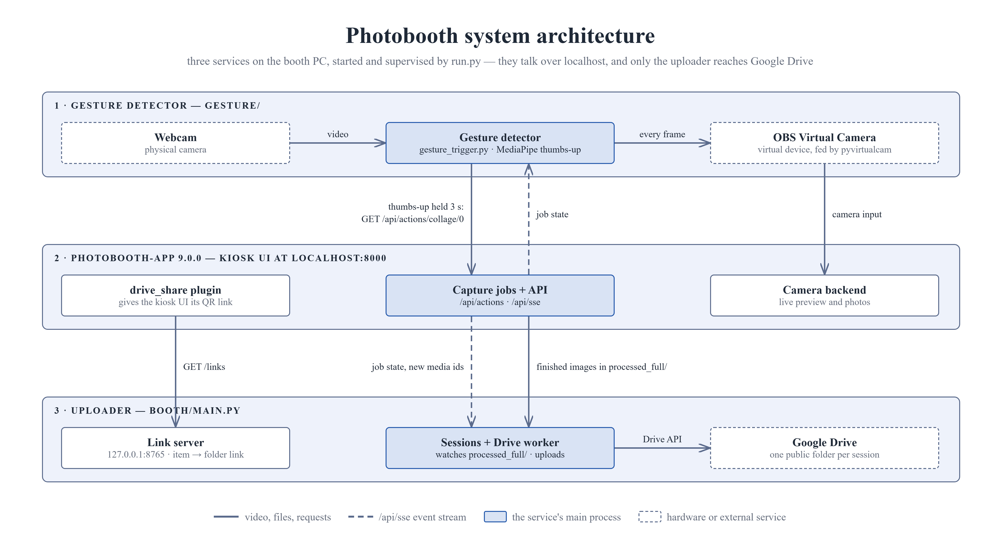

<h1 align="center"></h1>

# 📸 Photobooth-app on Windows with Python 🐍

The original custom-uploader pipeline on **photobooth-app 9.0.0**, uploading to Google Drive with **OAuth** (so it works on a free Gmail account).

## 📁 Repo layout

Two **independent uv projects** — each has its own `pyproject.toml`, `uv.lock` and `.venv`. They are deliberately *not* a uv workspace, so photobooth-app's `opencv-python-headless` and MediaPipe's `opencv-contrib-python` never share an environment.

```
cpre-photobooth/
├─ .env, .env.example     shared settings for both projects
├─ booth/                 uv project → booth/.venv
│  ├─ main.py             Drive uploader (entry point)
│  ├─ uploader/           its modules: SSE, sessions, folder pool, links, Drive worker
│  ├─ tests/              uploader + plugin tests
│  ├─ photobooth-data/plugins/drive_share/   shows the Drive link as photobooth-app's QR
│  ├─ photobooth-data/    photobooth-app's config, userdata, media, database
│  └─ token.json, client_secret.json   (gitignored)
├─ gesture/               uv project → gesture/.venv
│  └─ gesture_trigger.py  thumbs-up capture trigger
├─ run.py                 starts all three services and keeps them running (stdlib only)
├─ stop.py                stops booth processes left over from an earlier start
└─ docs/
```

## 🧩 System Architecture

Which service talks to which, and in which direction:



The figure has three rows, one per service, and nine connections:

- **Gesture detector** — reads the webcam and forwards every frame to the OBS Virtual Camera, which is photobooth-app's camera input. A thumbs-up held for 3 seconds sends `GET /api/actions/collage/0` to photobooth-app.
- **photobooth-app** — publishes its job state on the `/api/sse` event stream, which the gesture detector and the uploader both follow, and writes the finished images into `processed_full/`. Its `drive_share` plugin sends `GET /links` to the uploader's link server to get the QR link for the kiosk UI.
- **Uploader** — picks up the finished images and uploads them through the Drive API into one public Google Drive folder per session. It is the only service that talks to Google Drive; everything else stays on `localhost`.

The image is exported from the figure in [docs/ARCHITECTURE.md](docs/ARCHITECTURE.md); edit it there.

## 🔄 How it works

Three services run side by side. `run.py` starts them in this order and restarts any that exits.

### 👍 1. Gesture detector — `gesture/gesture_trigger.py`

Makes the booth hands-free. It runs in `gesture/.venv`.

- **Owns the webcam.** On Windows only one process can open the camera, so it reads the webcam and forwards every frame to the **OBS Virtual Camera**, which photobooth-app uses as its camera.
- **Detects the gesture.** MediaPipe finds the hands in each frame. A **thumbs-up held for 3 seconds** sends `GET /api/actions/collage/0` to photobooth-app, the same request the on-screen button sends.
- **Keeps photos clean.** It follows photobooth-app's `/api/sse` event stream and draws the hand skeleton and progress ring only while the booth is idle, so they never appear in a photo.

It is optional: with `uv run run.py --no-gesture` photobooth-app reads the webcam directly and guests use the on-screen button. See [docs/GESTURE.md](docs/GESTURE.md).

### 📸 2. photobooth-app 9.0.0

The camera, countdown, collage and kiosk UI at `http://localhost:8000`. It runs in `booth/.venv`, from `booth/photobooth-data/`.

- **Runs the capture job** and writes the finished images into `booth/photobooth-data/media/processed_full/`.
- **Publishes the job state** (start, countdown, capture, present, finished) on `/api/sse`. The other two services follow it.
- **Shows the QR code itself**, in the presenter after a capture and in the gallery. Its `drive_share` user plugin (`booth/photobooth-data/plugins/drive_share/`) gets the item's link from the uploader. No separate QR window is opened.

### ⬆️ 3. Uploader — `booth/main.py`

Puts each session into one public Google Drive folder. It runs in `booth/.venv` and never touches the camera. It follows photobooth-app's job over `/api/sse` and watches `processed_full/` with `watchdog`. For each session it:

- takes a Google Drive sub-folder that was **created and made public in advance** (anyone with the link: reader) and renames it to the session's timestamp, under `MAIN_FOLDER_ID`,
- links every file name and media id of the session to that folder, and serves those links to the `drive_share` plugin on `127.0.0.1:8765`,
- **uploads** the captures into the folder when the job finishes.

### 🎬 One session, start to finish

1. A guest holds a thumbs-up for 3 seconds (or presses the on-screen button), and photobooth-app starts the job.
2. The uploader sees the job start and takes the prepared Drive folder, so the session's link is known before the first photo.
3. photobooth-app counts down, captures, builds the collage and writes the images. The uploader adds each new file to the session.
4. photobooth-app presents the collage and asks the plugin for its link. The **QR code** to the session's folder is on screen at once.
5. The job finishes. The uploader uploads the session's images into the folder, and the gesture overlay returns after a short cooldown.

This keeps the "one folder + one QR per session" experience, with the QR on screen as soon as the collage is presented, and by talking to the Google Drive API directly it avoids the rclone/native-sharing bugs in photobooth-app 9's synchronizer. For the full pipeline see [docs/PIPELINE.md](docs/PIPELINE.md).

## ✅ Prerequisites

- **[uv](https://docs.astral.sh/uv/)** — installs Python and both projects' dependencies. `booth/.python-version` pins **Python 3.14** (the verified build); uv downloads it if it's missing.
- **photobooth-app 9.0.0** (installed by `uv sync`). No separate `ffmpeg` / `libjpeg-turbo` needed — v9 bundles them.
- **OBS Studio** for the gesture trigger's virtual camera — see [docs/GESTURE.md](docs/GESTURE.md).
- A **Google Cloud project** with the **Drive API enabled**.
- An **OAuth client ID of type _Desktop app_** → download it as `client_secret.json`.
- The **OAuth consent screen Published** ("In production"), so the refresh token doesn't expire every 7 days. Add your account as a test user if you keep it in Testing.
- A **Drive folder** you own, to hold the session sub-folders → note its **folder ID** (from the URL).

## 🔧 Setup

Create both environments from their lockfiles:

```bash
uv sync --locked --project booth
uv sync --locked --project gesture
```

Each `uv.lock` pins every package version of a known-good booth, so `--locked` reproduces it exactly (and fails instead of silently upgrading). `booth/uv.lock` holds photobooth-app 9.0.0 with all its dependencies plus the uploader's (`google-api-python-client`, `google-auth-oauthlib`, `google-auth-httplib2`, `watchdog`, `qrcode`, `pillow`, `python-dotenv`).

Manage packages with uv only — `uv add` / `uv remove` / `uv lock --upgrade-package <name>` inside `booth/` or `gesture/` — never `pip install` into either `.venv`: `uv sync` makes an environment match its lock exactly and removes anything installed by hand.

Put your **`client_secret.json`** (the Desktop OAuth client) in **`booth/`**, then create **`.env`** in the repo root — copy `.env.example` and fill in your folder id:

```bash
cp .env.example .env
```

```.env
MAIN_FOLDER_ID={your google drive folder id}
# Optional (defaults shown):
CLIENT_SECRET_FILE=client_secret.json
TOKEN_FILE=token.json
WATCH_DIR=./photobooth-data/media/processed_full
SESSION_QUIET_SECONDS=3
```

`token.json`, `client_secret.json`, and `.env` are **gitignored** — they are secrets. Never commit them.

### 🔑 First run — authorize once

Run `main.py` once; a browser opens → sign in → **Allow**. That writes `booth/token.json`. (If you see "Google hasn't verified this app", choose **Advanced → Go to … → Allow** — it's your own client.)

### 💻 Running on another machine (new booth)

A booth has **two** configs, with different portability:

**1. The uploader (`main.py`) — fully portable.** On the new machine, set up both projects (see [Setup](#-setup)) and copy over just:

- `booth/token.json` — makes the machine upload as *your* Google user with **no browser step** (it already contains the refresh token + client id/secret). All booths then upload into the same Drive folder.
- `.env` — `MAIN_FOLDER_ID` is shared across booths.

You do **not** need `client_secret.json` on the extra machines once `token.json` exists.

**2. The photobooth-app config (`booth/photobooth-data/config/config.json`) — portable except the camera.** Copy your `config.json` to reuse all the creative settings (collage/merge definitions, canvas sizes, gallery, sharing, UI). Then fix the **one machine-specific field**:

- `cameras.group_backends[].backend_config.device_identifier` — this names the *specific* camera on your machine (e.g. `"Integrated Webcam"`). With the gesture trigger it is `"OBS Virtual Camera"` on every booth, and the machine-specific webcam name moves to `GESTURE_CAMERA` in `.env`. Without it, it must match that machine's camera, or capture won't start. Set it in photobooth-app's admin UI (it lists the available cameras), or edit `config.json` directly.
- If the new machine uses a different camera *type* (Raspberry Pi cam, DSLR/gphoto2), also change `backend_type` accordingly.
- The `hardwareinputoutput.gpio_*` (Pi pins) and `misc.cmd_shutdown`/`cmd_reboot` (Linux commands) only matter on those platforms; leave them otherwise. Regenerating `misc.secret` per install is optional but tidy.

> `config.json`, `token.json`, `client_secret.json`, and `.env` are all **gitignored** — copy them between machines manually (USB / secure transfer), never via the public repo.

## 🚀 Run

From the repo root, one command starts all three services and keeps them running:

```bash
uv run run.py
```

Touch-only booth (no gesture trigger):

```bash
uv run run.py --no-gesture
```

Open `http://localhost:8000`, show a thumbs-up for 3 seconds (or press the on-screen button); the presenter shows the collage with the QR code to its Drive folder, and `main.py` uploads the images. **Ctrl+C** stops everything.

`run.py` is a small supervisor that uses only the standard library. It imports nothing from `booth/` or `gesture/`; it starts each service with `uv run` in its own folder, so each still runs in its own `.venv`. It:

1. **Checks before starting**, and refuses to start with a clear message if something is wrong: `uv` and both `.venv`s exist, `.env` has `MAIN_FOLDER_ID`, `booth/token.json` (or `client_secret.json`) exists, photobooth-app's camera matches the mode (`"OBS Virtual Camera"` with the gesture trigger, your real webcam with `--no-gesture`), the camera resolution in `.env` is valid, and nothing is already running on port 8000.
2. **Sets the camera resolution and frame rate from `.env`** (see below) in photobooth-app's `config.json`, and passes the same values to the gesture trigger.
3. **Starts in order, waiting until each one is really ready:** the gesture trigger (until it streams to the virtual camera), then photobooth-app (until `http://localhost:8000` answers), then the uploader.
4. **Restarts any service that exits**, waiting 1 s, 2 s, 4 s … up to 60 s between tries, so a permanently broken one doesn't spin. photobooth-app reads the gesture trigger's virtual camera, so while the gesture trigger is down photobooth-app is stopped too, and started again once the camera streams.
5. **Logs** every line to the console, prefixed `[gesture]` / `[photobooth]` / `[uploader]`, and to `logs/<service>.log` (gitignored). Supervisor messages (starts, crashes, restarts) are in `logs/run.log`.

`python run.py` works too, since it needs no packages.

**Camera resolution and frame rate:** set them once, in `.env`:

```
CAMERA_WIDTH=1280
CAMERA_HEIGHT=720
CAMERA_FPS=30
```

These are the defaults when unset. On every start, before photobooth-app is launched, `run.py` writes them into the active camera's `cam_resolution_width` / `cam_resolution_height` / `cam_framerate` in `booth/photobooth-data/config/config.json`, and the gesture trigger streams the virtual camera at the same size. When it changes `config.json` it logs the change (e.g. `WebcamPyav 1920x1080@30 -> 1280x720@30`) and keeps the previous file as `config.json_backup-<time>` (gitignored). `.env` wins: a resolution changed in photobooth-app's admin UI is replaced on the next `run.py` start. The older `GESTURE_WIDTH` / `GESTURE_HEIGHT` / `GESTURE_FPS` names still work. The collage `canvas_width` / `canvas_height` are **not** changed: they are the finished collage's size, and the photo slots in `merge_definition` are placed in canvas pixels, so change those yourself in the admin UI.

**"WinError 10048" / port 8000 already in use:** an earlier start is still running, usually because its terminal was closed instead of stopped with Ctrl+C. Stop the leftovers, then start again:

```bash
uv run stop.py
```

It stops only this repo's processes (photobooth-app, `main.py`, `gesture_trigger.py`, `run.py`); `--dry-run` lists them without stopping anything. If an unrelated program holds port 8000, it says so and leaves it running.

**Touch-only booth:** `--no-gesture` needs photobooth-app's camera `device_identifier` set back to your webcam (e.g. `"Integrated Webcam"`) in its admin UI or `config.json`. `run.py` checks this and won't start until it matches.

### 🧰 Run by hand (three terminals)

To work on one service, or to see each service in its own window, start them yourself in three Windows Terminal tabs from the repo root, in this order. No venv activation — `uv run` picks the right `.venv` from the folder you're in.

**Tab 1 — gesture trigger** (first, so the virtual camera is already streaming when photobooth-app opens it)
```bash
cd gesture
uv run gesture_trigger.py
```

**Tab 2 — the photobooth app**
```bash
cd booth/photobooth-data
uv run photobooth
```
Open `http://localhost:8000`. (uv finds the `booth` project from the parent folder; running it from inside `photobooth-data` keeps all its `config/`, `database/`, and `media/` folders there.)

**Tab 3 — the uploader**
```bash
cd booth
uv run main.py
```

Touch-only booth by hand: set the camera back to your webcam as above, and run only tabs 2 and 3. Started by hand, nothing restarts a service that crashes, and nothing copies `CAMERA_WIDTH` / `CAMERA_HEIGHT` / `CAMERA_FPS` into `config.json` — after changing them, start once with `uv run run.py` (or set the same values in photobooth-app's admin UI).

## 🎯 Tuning to your app version / collage

- `WATCH_DIR` — the folder photobooth-app writes finished images to (default `media/processed_full`, unchanged in v9).
- `SESSION_QUIET_SECONDS` — only used when the uploader can't follow photobooth-app's event stream (or files arrive outside a job): a burst of files is one session once no new file has appeared for this long (default `3`). Normally a session runs from the job's start to `finished`, with no count or timer to tune.
- `PHOTOBOOTH_URL`, `LINK_SERVER_PORT`, `LINK_WAIT_SECONDS`, `LINKS_FILE` — see `.env.example` and [docs/PIPELINE.md](docs/PIPELINE.md).
- photobooth-app's **Admin → UI settings → `gallery_show_qrcode`** must be on (it is in the committed `config.json`); `qrcode_text_above` / `qrcode_text_below` set the text around the QR.

## 🌿 Other branches

- `photobooth-app-4.0.0` — the original Oct 2024 version.

## 📖 Reference

photobooth-app — [github](https://github.com/photobooth-app/photobooth-app.git) · [docs](https://photobooth-app.org/)